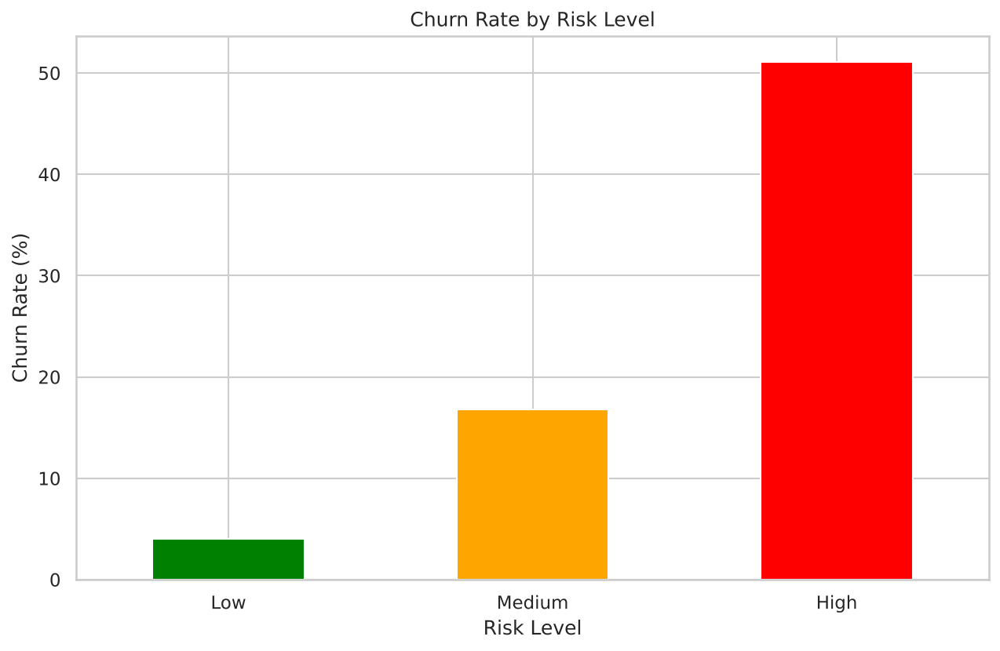
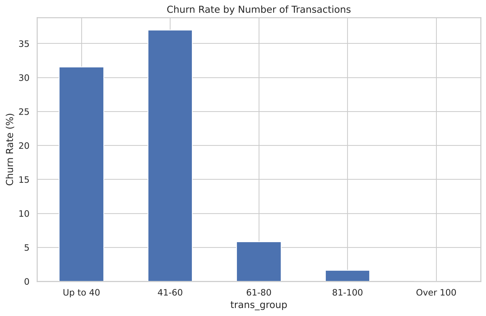
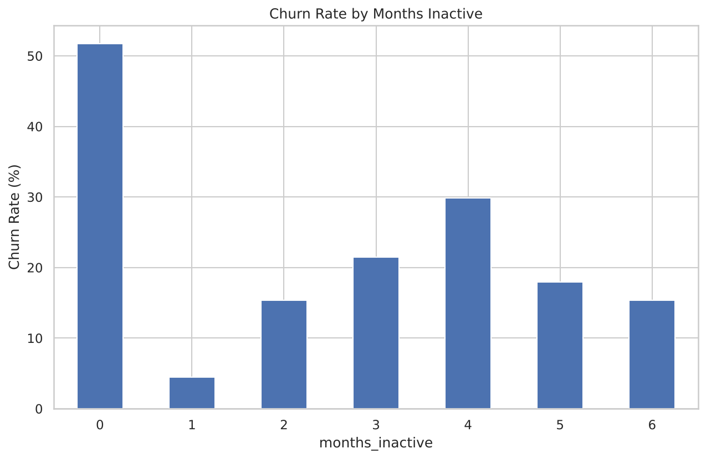
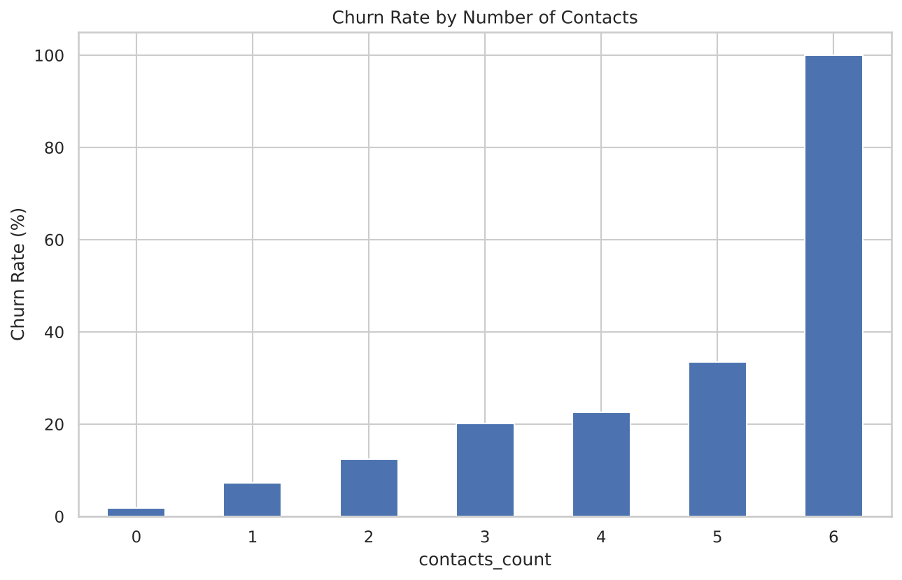

# Credit Card Customer Churn Analysis
### Identifying At-Risk Customers and Retention Strategies

**Python (pandas, matplotlib, seaborn) | Jupyter Notebook**

---

## 1. Project Overview

Winning a new credit card customer costs far more than keeping an existing one. This project analyses **10,127 credit card customers** of a bank to find out **who is leaving, what warning signs come before it, and which customers the retention team should contact first.**

The analysis ends with a simple, explainable **High / Medium / Low risk segmentation** (no machine learning) and a set of recommendations a retention manager could act on.

**Start here:** [`notebooks/churn_analysis.ipynb`](notebooks/churn_analysis.ipynb) contains the full analysis with charts.

## 2. Business Questions

1. What is the overall churn rate, and how much does it matter to the business?
2. Which customer segments (age, gender, income, education, marital status, card type) churn the most?
3. Do customer behaviours (inactivity, number of transactions, contacts with the bank, products held) signal that someone is about to leave?
4. Do high-value customers (high credit limit, high spending) leave more or less than others?
5. Which customers are at high, medium or low risk right now, and what should the retention team do for each group?

## 3. Dataset

| Item | Detail |
|---|---|
| File | `data/BankChurners.csv` |
| Rows | 10,127 customers (one row per customer) |
| Columns | 21 (demographics, account details, spending and activity) |
| Target | `Attrition_Flag`: *Existing Customer* or *Attrited Customer* |
| Source | Credit card customers dataset, publicly available on Kaggle |

See [`docs/data_dictionary.md`](docs/data_dictionary.md) for every column.

## 4. Tools Used

- **Python:** pandas, matplotlib, seaborn
- **Jupyter Notebook**
- **Git / GitHub**

## 5. Project Structure

```
bank-churn-analysis/
├── data/
│   ├── BankChurners.csv             # original data (never edited)
│   └── churn_dashboard_data.csv     # cleaned data with features and risk levels
├── notebooks/
│   └── churn_analysis.ipynb         # full analysis, step by step
├── images/                          # charts used in this README
├── docs/
│   ├── data_dictionary.md           # meaning of every column
│   ├── methodology.md               # cleaning, features, risk scoring, limitations
│   └── insights_and_recommendations.md
├── requirements.txt
├── .gitignore
├── LICENSE
└── README.md
```

## 5a. Approach

1. **Setup and loading:** imported the data and checked its size and types.
2. **Cleaning:** standardised column names, checked duplicates and missing values, found hidden missing values labelled `"Unknown"` (kept as their own category rather than deleted), reviewed outliers (kept, as they are genuine high-value customers), and created a `churn_flag` (1 = churned, 0 = existing).
3. **Feature engineering:** age groups, tenure groups, average spend per transaction, and an inactivity flag.
4. **Exploratory analysis:** compared **churn rates** inside each segment (not raw counts, because only about 16% of customers churned).
5. **Risk segmentation:** a rule-based score from four warning signs.
6. **Insights and recommendations:** plain-language findings and actions.
7. **Export:** a tidy data file prepared for a Power BI dashboard.

## 6. Key Findings

| # | Finding | Evidence |
|---|---|---|
| 1 | **About 1 in 6 customers has left**, and it affects revenue | 1,627 of 10,127 customers (16.1%) churned. They accounted for 11.3% of all card spending and held 15.1% of total credit limit. |
| 2 | **Demographics explain little** | Churn by age group ranged only from 13.3% to 16.6%. Gender: 17.4% (female) vs 14.6% (male). |
| 3 | **Low card usage is the strongest warning sign** | Customers with 60 or fewer transactions churn at about 31% to 37%, versus under 6% above 60. Churned customers averaged 44.9 transactions vs 68.7 for existing customers. |
| 4 | **Inactivity and repeated contacts are early warnings** | Inactive 3+ months: 22.0% churn vs 11.2%. Churn rises from 1.8% with no contacts to 33.5% with five. |
| 5 | **Fewer products means higher churn** | 1 or 2 products: 25.6% to 27.8%. 4 to 6 products: 10.5% to 12.0%. |
| 6 | **Top spenders are loyal, but a valuable middle group is leaking** | Spending over 10K: 1.3% churn. The 5K to 10K band (1,130 customers): 21.8%. |
| 7 | **A simple risk score concentrates the problem** | The High risk group is 16% of customers but contains 51.8% of all churners. |

### Charts

| Churn rate by risk level | Churn rate by number of transactions |
|---|---|
|  |  |

| Churn rate by months inactive | Churn rate by contacts with the bank |
|---|---|
|  |  |

### Risk Segmentation

Each customer gets **1 point per warning sign**: 60 or fewer transactions, inactive 3+ months, 3+ contacts with the bank, only 1 or 2 products.

| Risk level | Score | Customers | Churn rate |
|---|---|---|---|
| **High** | 3 to 4 | 1,648 | **51.1%** |
| **Medium** | 2 | 3,483 | 16.8% |
| **Low** | 0 to 1 | 4,996 | 4.0% |

## 7. Recommendations

1. **Create a monthly High risk call list** for the retention team (1,648 customers, about half of all churners).
2. **Re-activate drifting customers** with an automatic nudge or reward when card usage drops.
3. **Fix the causes of repeated contacts:** escalate customers with 3+ contacts for first-contact resolution.
4. **Cross-sell a second or third product** to customers holding only 1 or 2.
5. **Protect the 5K to 10K spenders** and review the experience of customers with credit limits under 2.5K.

Each recommendation has a success measure in [`docs/insights_and_recommendations.md`](docs/insights_and_recommendations.md). Actions should be piloted on a small group first.

## 8. Limitations

- **The data is one snapshot with no dates,** so I cannot show trends over time or prove cause. Low card usage may be a symptom of a customer already leaving, not only a reason.
- **The risk rules were built and checked on the same data,** so they will look better than they would on new customers. They are a screening tool, not a validated prediction model.
- **Cut-offs were chosen from the charts** (60 transactions, 3 months, 3 contacts, 2 products). Other reasonable cut-offs may give slightly different results.
- **Some groups are very small:** 20 Platinum cardholders (25.0% churn), 54 customers with 6 contacts. These figures are indicative only.
- **"Unknown" values** in education (15.0%), income (11.0%) and marital status (7.4%) were kept as a category, not removed.

## 9. Next Steps

- Build a Power BI dashboard from `data/churn_dashboard_data.csv` (KPI cards, churn by segment, High risk customer table).
- Test the risk rules on held-out data to check how well they hold up on new customers.

## 10. How to Run

1. Download the repository (**Code → Download ZIP**) and unzip it.
2. Install the libraries:
   ```bash
   pip install -r requirements.txt
   ```
3. Open the notebook:
   ```bash
   jupyter notebook notebooks/churn_analysis.ipynb
   ```
4. Choose **Kernel → Restart & Run All**.

## 11. Author

**Mohammad Adhil**
MBA in Business Analytics | Aspiring Data Analyst | Hyderabad, India
Skills: SQL, Python, Excel, Power BI
